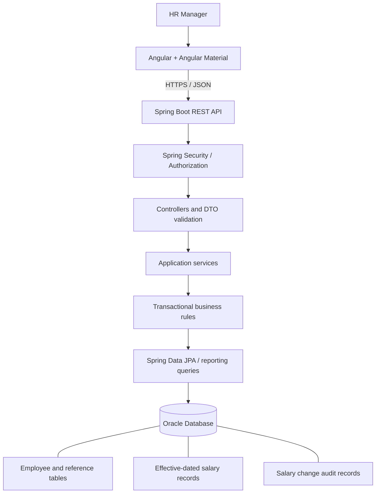

# PayFlow — Architecture

## Architectural approach

Use a **modular monolith**: one Angular web application, one Spring Boot REST service, and one Oracle relational database. Keep clear boundaries between API, business rules, persistence, security, and reporting. This is sufficient for the stated 10,000-employee scope and keeps deployment, local development, and debugging understandable. If future evidence shows independent scaling or team ownership needs, modules can later be separated behind stable APIs.

## Component and data flow

## Responsibilities

### Frontend

- Angular feature areas: dashboard, employee directory, employee details, salary history/editor, and reports.
- Angular Material for accessible, consistent forms, tables, dialogs, and navigation; chart library selected and pinned during implementation.
- Use typed API services and reactive forms. Use server-side paging, sorting, and filters; do not fetch all employees to compute counts or salary statistics in the browser.
- Provide loading, empty, validation, authorization, and recoverable API error states. Keep business rules authoritative on the backend.

### Backend

Organize code by feature/module (`employee`, `compensation`, `reporting`, `security`, `audit`) with consistent internal layers:

- **Controller:** REST routing, request/response DTOs, validation mapping; no business logic.
- **Service:** use cases, effective-date validation, authorization-sensitive operations, and transaction boundaries.
- **Repository:** JPA persistence and explicit aggregate queries; avoid accidental N+1 query patterns.
- **DTO/mapper:** do not serialize persistence entities directly.
- **Exception handling:** consistent RFC 9457-style problem responses where supported by the chosen Spring version; do not expose stack traces or database details to clients.

### Database

- Version schema with Flyway or Liquibase using Oracle-compatible migration scripts; choose one tool and pin its version. Do not rely on Hibernate auto-creating production schema.
- Use primary/foreign keys, unique constraints, check constraints, and indexes aligned with search and reporting access paths.
- Use `NUMBER` for money/decimal values and `DATE` for date-only effective periods. Use stable IDs and reference tables for departments/countries.
- Store salary history separately from employee profile data. Keep audit metadata distinct from the compensation records.

### Security

- Protect employee and compensation APIs by default. Use Spring Security and a maintained JWT implementation or secure cookie-based session approach; select one and document the trade-off before implementation.
- If JWT is selected, prefer a Secure, HttpOnly cookie where the deployment architecture supports it; address CSRF and CORS deliberately. Do not persist bearer tokens in browser local storage by default.
- Hash passwords using BCrypt or another supported adaptive password hash. Never commit secrets or real credentials. Use environment variables or a secret manager for signing keys and database credentials.
- Enforce authorization in backend services/controllers, not only by hiding UI controls. Keep salary amounts, passwords, tokens, and sensitive request bodies out of logs.

## API conventions

- Prefix endpoints with `/api/v1`.
- Use resource-oriented routes for employees and their salary history, plus dedicated reporting endpoints (for example, `/api/v1/reports/compensation`).
- Validate inputs on the server. Use explicit DTOs, ISO date strings, ISO 4217 currency codes, bounded page sizes, stable sorting, and consistent error payloads.
- Make list endpoints paginated. Whitelist sortable fields rather than interpolating arbitrary user input into SQL.
- Apply filters consistently to CSV exports and report queries. Stream or page large exports instead of buffering unbounded result sets.

## Reporting and performance

- Calculate headcount and compensation statistics in Oracle through aggregate queries.
- Group compensation outputs by **currency and pay frequency**. Do not combine amounts in different currencies or frequencies into one total. Foreign-exchange conversion and annualization policies are not in version one.
- Index employee number, normalized email (if implemented), and columns commonly used for country, department, job title, and status filters. Validate choices using query plans and realistic seeded data rather than adding indexes indiscriminately.
- Use server-side pagination, select only needed columns, use batch seed writes, and test representative directory/report queries against Oracle.
- Set realistic request/page-size limits and database connection pool settings. Measure before adding caching or asynchronous infrastructure.

## Testing strategy

- **Unit tests:** service rules, salary effective-date calculations, validation, currency/frequency grouping, and error mapping with JUnit 5/Mockito.
- **Web tests:** request validation, status codes, authorization, and error responses with MockMvc or the chosen Spring test approach.
- **Angular tests:** forms, API services, filters/pagination interactions, loading/error states, and currency-labelled results.
- **Oracle verification:** use an Oracle integration/smoke-test path for migrations, constraints, locking, query behavior, and seeding. An H2-only suite is not sufficient evidence of Oracle compatibility.
- **End-to-end smoke test:** authenticate, search an employee, inspect history, record a current/future salary change, view updated analytics, export a report.

## Deployment outline

Build the Angular assets and deploy them through a static web server or supported hosting platform. Run the Spring Boot service separately and configure its Oracle connection, JWT/session secrets, allowed origins, and profile through environment-specific configuration. Provide Dockerfiles/Compose for reproducible local development where practical. Health checks must not leak infrastructure secrets. Record the actual deployment platform, URL, and verification steps once deployment is performed; do not claim deployment before testing it.
