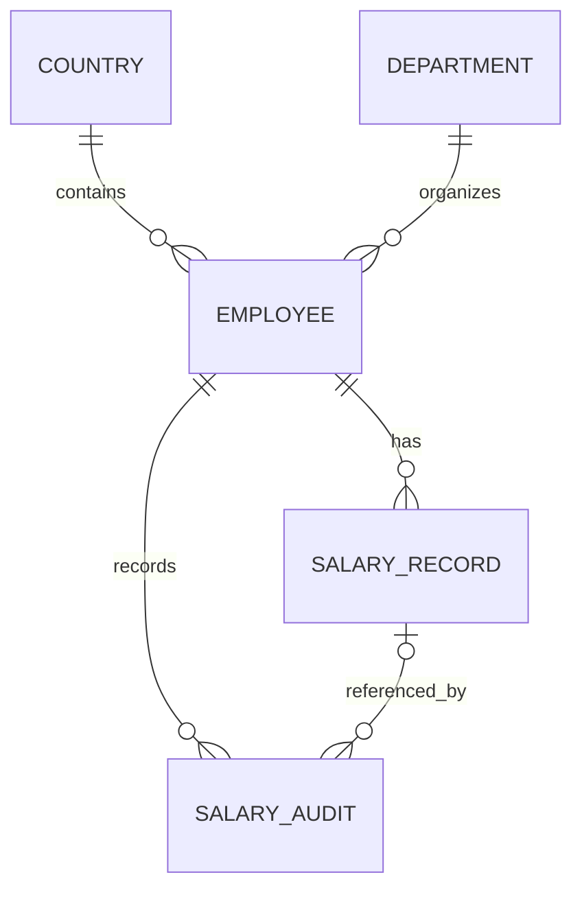

# PayFlow — Initial Data Model

## Modelling principles

Keep employee profile data separate from effective-dated compensation. Treat salary records as sensitive, retain history, use decimal money types, and perform salary changes in a transaction. The schema below is logical; concrete Oracle column lengths, names, and migration syntax must be finalized and tested against the selected Oracle version before implementation.

## Tables

### `EMPLOYEE`

| Column | Purpose / rule |
|---|---|
| `EMPLOYEE_ID` | Primary key; generated from an Oracle identity or sequence strategy. |
| `EMPLOYEE_NUMBER` | Required, unique business identifier. |
| `FIRST_NAME`, `LAST_NAME` | Required profile fields. |
| `EMAIL` | Required; trim and normalize case in the service before enforcing uniqueness. |
| `COUNTRY_CODE` | Foreign key to `COUNTRY`. |
| `DEPARTMENT_ID` | Foreign key to `DEPARTMENT`. |
| `JOB_TITLE` | Required or explicitly nullable according to the chosen validation policy. |
| `EMPLOYMENT_STATUS` | Constrained values such as `ACTIVE`, `ON_LEAVE`, `INACTIVE`. |
| `HIRE_DATE` | Required date. |
| `CREATED_AT`, `UPDATED_AT` | Audit timestamps. |

Do not hard-delete employees with compensation history. Use a status change so historical records and audit trails remain interpretable.

### `DEPARTMENT`

| Column | Purpose / rule |
|---|---|
| `DEPARTMENT_ID` | Primary key. |
| `DEPARTMENT_CODE` | Required, unique stable code. |
| `DEPARTMENT_NAME` | Required name. |

### `COUNTRY`

| Column | Purpose / rule |
|---|---|
| `COUNTRY_CODE` | Primary key, preferably ISO 3166-1 alpha-2. |
| `COUNTRY_NAME` | Required name. |
| `DEFAULT_CURRENCY_CODE` | ISO 4217 metadata only; it does not constrain an employee's actual salary currency. |

### `SALARY_RECORD`

| Column | Purpose / rule |
|---|---|
| `SALARY_RECORD_ID` | Primary key. |
| `EMPLOYEE_ID` | Required foreign key to `EMPLOYEE`. |
| `SALARY_AMOUNT` | Required Oracle `NUMBER(p,s)`; positive and within a documented precision/range. Java type: `BigDecimal`. |
| `CURRENCY_CODE` | Required ISO 4217 code, e.g. `INR`, `USD`, or `EUR`. |
| `PAY_FREQUENCY` | Constrained value such as `HOURLY`, `MONTHLY`, or `ANNUAL`. |
| `EFFECTIVE_FROM` | Required date; inclusive start of the period. |
| `EFFECTIVE_TO` | Nullable date; inclusive final day of the period. `NULL` means no known end. |
| `CHANGE_REASON` | Required for user-entered changes; bounded length. |
| `CREATED_BY`, `CREATED_AT` | Actor and timestamp that created the record. |

Constraints should include a foreign key, a check that amount is positive, a check that `EFFECTIVE_TO` is null or not earlier than `EFFECTIVE_FROM`, and a unique key on `(EMPLOYEE_ID, EFFECTIVE_FROM)`. Add indexes that support salary timeline and as-of-date lookups.

**Period semantics:** each record is valid from `EFFECTIVE_FROM` through `EFFECTIVE_TO`, inclusive. Current compensation as of date `D` is the record where `EFFECTIVE_FROM <= D` and (`EFFECTIVE_TO` is null or `EFFECTIVE_TO >= D`). Exactly one record should match an employee and date. A null end date is not itself enough to mean “current” if a future-dated record exists.

### `SALARY_AUDIT`

| Column | Purpose / rule |
|---|---|
| `SALARY_AUDIT_ID` | Primary key. |
| `EMPLOYEE_ID` | Required reference to employee. |
| `OLD_SALARY_RECORD_ID` | Nullable reference to the superseded/affected record. |
| `NEW_SALARY_RECORD_ID` | Nullable reference to the newly created record. |
| `ACTION_TYPE` | Constrained values such as `SALARY_CREATED`, `SALARY_CHANGED`, `FUTURE_CHANGE_SCHEDULED`, `FUTURE_CHANGE_REVISED`. |
| `ACTOR_ID` | Authenticated user identifier; do not store credentials. |
| `ACTION_AT` | Timestamp of the action. |
| `REASON` | Business reason, with length and content validation. |

Avoid copying salary amounts into free-form logs. If the assessment requires before/after values in the audit trail, store them in explicitly protected decimal/currency columns with tightly restricted access rather than in application logs.

## Relationships

## Effective-date rules

1. Each employee can have no more than one salary record effective on any calendar date.
2. For a salary update effective today or in the future, validate and adjust the affected timeline inside one database transaction. The service should identify the prior and next records, close the prior period to the day before the new start date where needed, and set the new period's end to the day before the next scheduled period where needed.
3. Serialize competing changes for the same employee, for example by locking the employee row with `SELECT ... FOR UPDATE` inside the transaction. A unique key on employee/start date does not prevent all overlapping date ranges, so overlap validation is a service invariant backed by transactional locking and tests.
4. Past-period corrections are excluded from v1. Do not accept a user-entered effective date earlier than the current business date. Existing historical records created by seeding remain readable.
5. Record the salary change and audit entry atomically. If any validation or write fails, roll back the entire change.
6. For the date used to determine “today,” use one documented business-time-zone policy consistently in the API, database access, tests, and UI. Use date-only values for effective periods.

## Reporting semantics

- **Headcount:** employee count by status/country/department, using defined inclusion rules.
- **Compensation metrics:** report amount and ISO currency and group by currency **and pay frequency**. Calculate employee count, minimum, average, maximum, and sum within each group.
- Do not describe the raw sum of different currencies/frequencies as a single global payroll total.
- Define a specific rule for whether terminated/inactive employees appear in historical or current reports; do not silently mix statuses.

## Seed-data expectations

Use deterministic fictional data, a fixed seed, and stable employee numbers. Seed exactly 10,000 employees and at least one current salary record per employee, with additional non-overlapping historical records for a subset. Seed execution must be explicitly enabled for local/demo environments, safe to rerun, and must not run automatically against production. The seeder must check its final counts and fail clearly if the expected invariant is not met.
